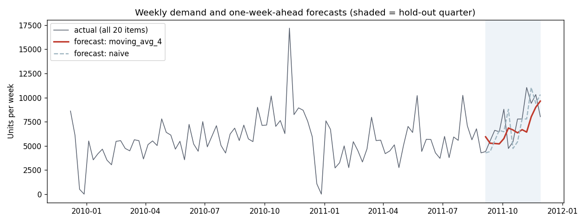

# Demand Forecasting & Inventory Planning

Weekly demand forecasting and safety-stock planning for a UK online retailer's products
(Online Retail II, 2009-2011): ABC-XYZ classification of ~4,000 products, a fair one-week-ahead
back-test of five forecasting methods on the top 20 products, and safety stock / reorder points
at 90, 95 and 99% service levels, showing how much stock better forecasts save.

**Report:** [reports/forecasting_report.md](reports/forecasting_report.md)



## Key results
- 4,600 products over 104 weeks; 990 A-products (22%) make 80% of revenue, but 832 of them are erratic (coefficient of variation > 1) and only one is stable.
- On the top 20 products, a 4-week moving average forecast best: WAPE 49% vs 63% for naive; choosing a method per product on the prior quarter did worse (54%), so one robust method beat per-item tuning.
- All methods under-forecast the pre-Christmas quarter (bias about -15%), pointing to a Q4 seasonal uplift.
- Better forecasts cut safety stock at 95% service and a 2-week lead time by 23% (£70K to £54K); moving to 99% service adds 41%.

## What it does
1. **Weekly demand** (`src/prepare.py`): cleaned transactions → units per product per complete Monday-Sunday week, with no-sale weeks as 0.
2. **ABC-XYZ** (`src/classify.py`): A/B/C by share of revenue (80/15/5%), X/Y/Z by week-to-week variability (coefficient of variation < 0.5, 0.5-1, > 1).
3. **Forecasting** (`src/forecast.py`): naive, seasonal naive (same week last year), 4-week moving average, exponential smoothing and a gradient-boosting model with lag features; rolling one-week-ahead back-test on the last 13 weeks, scored by WAPE and bias. Each product's method is chosen on the previous quarter, never on the test weeks.
4. **Inventory** (`src/inventory.py`): safety stock = z × σ(forecast error) × √lead time; reorder point = lead-time demand + safety stock; naive vs selected-method plans compared in units and £.
5. **Charts and report** (`src/charts.py`, `run.py`), **tests** (`tests/`), and **GitHub Actions** on every push.

## Run it yourself
```bash
python3.11 -m venv .venv
source .venv/bin/activate
pip install -r requirements.txt
pytest -q
python3 run.py
```
Copy `data/processed/transactions.parquet` from the e-commerce analytics project to skip the download,
or let it download the raw file from UCI.

## Data
Online Retail II, UCI Machine Learning Repository (Chen, 2019), CC BY 4.0. The weekly demand table is committed so CI can rerun.
