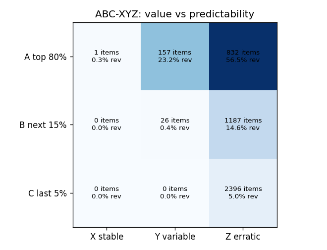
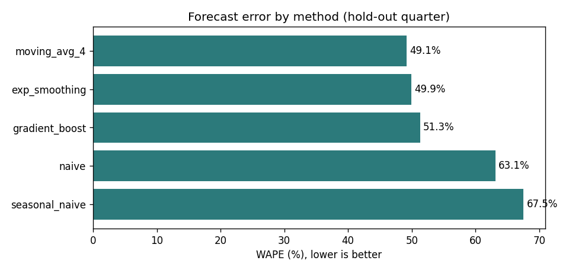
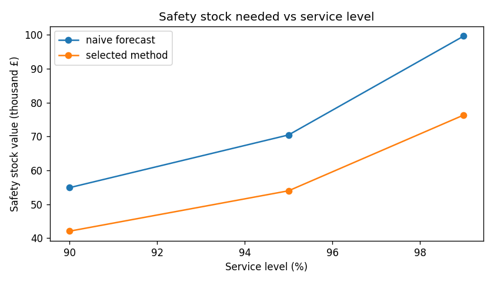

# Demand Forecasting & Inventory Planning Report

## 1. Key findings
- 4,600 products over 104 complete weeks (2009-12-07 to 2011-11-28).
- ABC: 990 A-products (21.5% of products) make 80% of revenue; only 1 A-products are stable (AX), 832 are erratic (AZ).
- Forecast hold-out: last 13 weeks for the top 20 products, one week ahead.
- Best single method: moving_avg_4 with WAPE 49.1% vs naive 63.1%; per-item methods chosen on a validation quarter give 54.2% (bias -14.8%).
- At a 95% service level and 2-week lead time, safety stock falls from £70,434 (naive) to £53,953 with the selected methods, a 23% saving.
- Raising service from 95% to 99% increases safety stock by 41% for every plan, because z rises from 1.64 to 2.33.

### Analyst commentary
<!-- COMMENTARY -->
Demand here is dominated by large, irregular wholesale orders: 990 products (22%) make 80% of revenue, yet 832 of them are erratic and only one is stable, so weekly forecast errors are high for every method. A simple 4-week moving average forecast best (WAPE 49% vs 63% for naive), because averaging smooths one-off bulk orders. Choosing a different method for each product on the previous quarter did worse (54%), which shows that with noisy data a single robust method beats fine-tuning that doesn't carry over. All methods under-forecast the pre-Christmas quarter by about 15%, so I would add a seasonal uplift for Q4 to avoid stock-outs. Even so, better forecasts cut the safety stock needed at 95% service by 23% (£70K to £54K), while moving from 95% to 99% service would raise it by 41%, a trade-off the business should choose deliberately.
<!-- COMMENTARY -->

## 2. ABC-XYZ classification
Items by class (rows: value, columns: predictability):

| abc | X | Y | Z |
| --- | --- | --- | --- |
| A | 1 | 157 | 832 |
| B | 0 | 26 | 1187 |
| C | 0 | 0 | 2396 |

## 3. Forecast accuracy (hold-out quarter)
| method | wape | bias | mae_units |
| --- | --- | --- | --- |
| moving_avg_4 | 0.4915 | -0.0964 | 181.9962 |
| exp_smoothing | 0.4993 | -0.1344 | 184.8851 |
| gradient_boost | 0.513 | -0.1846 | 189.9663 |
| selected per item (validation) | 0.5424 | -0.1482 | 200.8596 |
| naive | 0.631 | -0.0389 | 233.6577 |
| seasonal_naive | 0.6752 | 0.1274 | 250.05 |

Methods chosen per item on the validation quarter: {'exp_smoothing': 8, 'gradient_boost': 4, 'moving_avg_4': 3, 'seasonal_naive': 3, 'naive': 2}.

## 4. Inventory plan
| service_level | naive | selected | saving_value | saving_pct |
| --- | --- | --- | --- | --- |
| 0.9 | 54877.4811 | 42036.2701 | 12841.211 | 0.234 |
| 0.95 | 70434.4845 | 53952.9686 | 16481.5159 | 0.234 |
| 0.99 | 99616.8355 | 76306.7131 | 23310.1225 | 0.234 |

## 5. Method notes
- Weekly units per product (Monday-Sunday), partial first/last weeks removed, weeks with no sales filled with 0.
- One-week-ahead rolling back-test on the last 13 weeks; each item's method is chosen on the previous 13 weeks (validation), never on the test weeks.
- Safety stock = z × σ(weekly forecast error) × √lead time; reorder point = forecast demand over the lead time + safety stock; valued at each product's average selling price.
- Limits: wholesale demand is lumpy; two years of history give only one prior season for seasonal methods; stock is valued at selling price, not cost.
